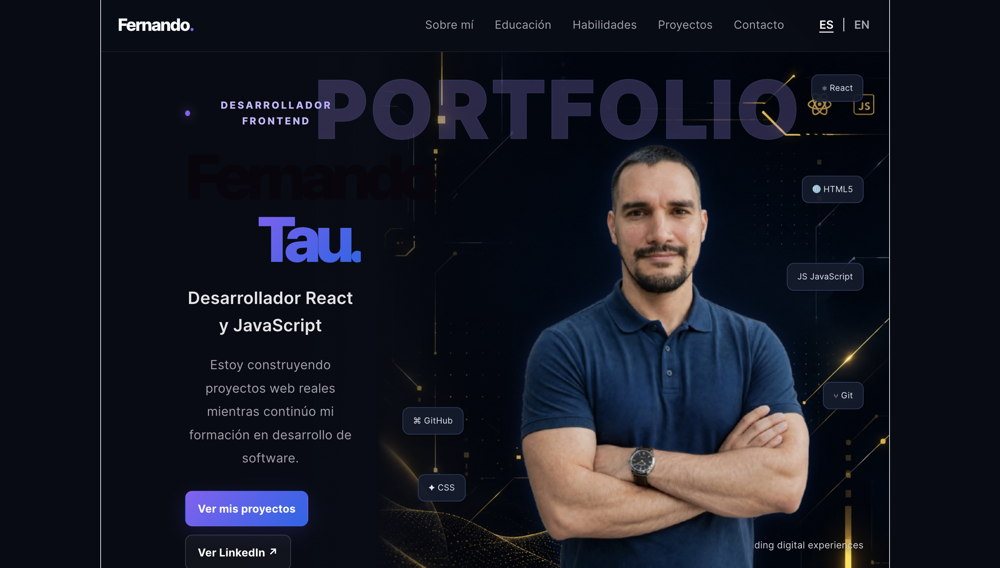

# Personal Portfolio

A personal web portfolio built with React and Vite.

## 👨‍💻 About the Project

This portfolio showcases my profile as a web developer, my technical skills, education and projects.

It was created to present my work, share my learning journey and connect with potential employers and collaborators.

## 📸 Preview



## ✨ Features

- Personal introduction and developer profile
- Technical skills section
- Education and certifications
- Featured development projects
- Contact section
- Animated visual elements
- Responsive design

## 🛠️ Technologies

- React
- JavaScript
- Vite
- CSS
- Framer Motion
- React Icons

## 🌐 Live Demo

[Visit My Portfolio](https://fernando-portfolio-ruby.vercel.app/)

## 💻 Run Locally

1. Clone the repository:

   ```bash
   git clone https://github.com/Matt091088/fernando-portfolio.git

   cd fernando-portfolio

   npm install

   npm run dev
